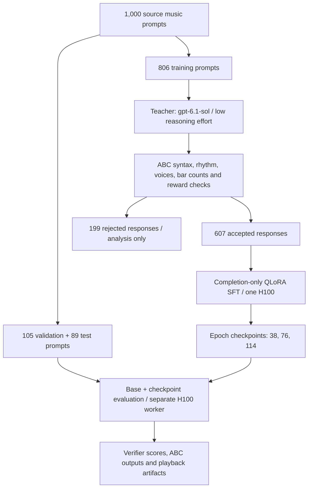

# Music Response Distillation

Train a language model to compose ABC music using verified teacher responses, then
measure its performance on held-out composition prompts.

[Hugging Face dataset](https://huggingface.co/datasets/suunny/music-teacher-distillation)
· [Run instructions](docs/running.md)
· [Evaluation results](evaluation/summary.json)
· [GPU runtime records](evaluation/runtime.json)

This project distills **607 verified teacher responses** into **Qwen3.8-27B** using
completion-only QLoRA supervised fine-tuning. Across 105 validation prompts, mean
verifier reward increased from **0.086 to 0.284**, and strict acceptance increased
from **5 to 16 outputs**. The repository includes teacher collection, verification,
training, checkpoint evaluation, playback artifacts, and cost tracking.

## Training flow



1. **Prepare prompts.** Deterministically split the source music tasks into training,
   validation, and test partitions.
2. **Collect and verify.** Generate one final teacher answer per training prompt.
   Retain accepted answers for SFT and preserve rejected answers with their reasons.
3. **Train the student.** Predict the next token of the teacher's answer, masking
   prompt and padding tokens from the loss. Update LoRA parameters with cross-entropy.
4. **Evaluate checkpoints.** Compare the unadapted base model and each epoch using
   fresh generations. Training-set and held-out scores have separate denominators;
   aborted generations remain zero-reward outcomes.

The learning method is **off-policy response distillation**: teacher text supplies
hard token targets for SFT. Teacher logits are not collected, and this run does not
apply a reinforcement-learning update. The results below cover validation; publishing
test prompts does not establish a reported test-set result.

## Results

All four checkpoints use the same **105 validation prompts**.

| Metric | Base | Epoch 1 | Epoch 2 | Epoch 3 |
|---|---:|---:|---:|---:|
| Optimizer step | 0 | 38 | 76 | 114 |
| Mean verifier reward | 0.0857 | 0.1601 | 0.1912 | **0.2838** |
| Passes all implemented checks | 5 / 105 | 10 / 105 | 9 / 105 | **16 / 105** |
| Strict acceptance rate | 4.8% | 9.5% | 8.6% | **15.2%** |
| Zero-reward outputs | 83 | 78 | 74 | **61** |

The final reward is **3.31× the base reward**, an absolute increase of **0.1981**.
These are results from one run, without repeated-seed uncertainty estimates or human
listening scores. Positive verifier reward does not guarantee full instruction compliance.

The main remaining errors are excessive composition length, incorrect beats per bar,
and inconsistent voices. The generation guard checks completed lines and can miss a
runaway unfinished line. These limitations matter alongside the reward improvement.

Evidence: [exact summary](evaluation/summary.json),
[420 per-prompt validation records](evaluation/validation-scores.jsonl), and
[saved training settings and IDs](evaluation/training-settings.json).

## Training configuration

| Setting | Recorded configuration |
|---|---|
| Student | `Qwen/Qwen3.8-27B` |
| Student revision | `1d4bf0f2ff6012fd82039f2fa52739d0dd7c60c0` |
| Teacher | `gpt-6.1-sol`, low reasoning effort |
| Training data | 607 accepted teacher responses |
| Objective | Completion-only supervised cross-entropy |
| Quantization | 4-bit NF4, double quantization; BF16 compute |
| LoRA | Rank 16, alpha 32, dropout 0.05 |
| Epochs / optimizer updates | 3 / 114 |
| Microbatch / gradient accumulation | 1 / 16; nominal effective batch 16 |
| Learning rate / schedule | `1e-4` / cosine, one warmup step |
| Sequence length | 11,008 selected for this run; configured ceiling 16,384 |
| Checkpointing | Epoch boundaries; gradient checkpointing enabled |

The longest training sequence contained 11,000 tokens. The trainer selected a padded
length of 11,008 within the configured ceiling. See [config.json](config.json) and the
[saved run settings](evaluation/training-settings.json) for their distinct roles.

## GPUs, training time, and inference

The Modal architecture separates training and inference into **two independently
scheduled GPU roles**, each requesting **one NVIDIA H100**. The inference device was
recorded as **NVIDIA H100 80GB HBM3**. Teacher collection is coordinated on CPU and
uses a hosted teacher service; its provider-side GPU hardware is not recorded here.

This is a single-GPU QLoRA training job plus a separate single-GPU inference job.
It does not use DDP, FSDP, or multi-GPU tensor parallelism. The coordinator can overlap
training and evaluation, but **the saved worker timestamps for this run show sequential
execution**: inference began after the recorded training workers ended. Two GPU roles
therefore does not mean two GPUs were simultaneously active in these measurements.

| Measurement | Recorded value | Scope |
|---|---:|---|
| Final trainer runtime | **40m 03s** | `train_runtime` in the final saved trainer result |
| Training worker invocation 1 | 41m 34s | Full recorded invocation |
| Training worker invocation 2 | 41m 21s | Full recorded invocation |
| Total recorded training GPU time | **1h 22m 55s** | Sum of both training invocations |
| Inference worker time | **4h 35m 33s** | Full recorded inference invocation |
| Total recorded GPU time | **5h 58m 28s** | Training + inference; about 5.97 GPU-hours |
| vLLM startup | 5m 54s | Included in inference worker time |
| Peak training memory allocated / reserved | 44.77 / 48.30 GiB | PyTorch CUDA allocator metrics |

Worker times include loading, scoring, and waiting inside the recorded invocation;
they exclude container provisioning before function entry. The training total includes
both invocations rather than presenting the final trainer metric as the entire compute
budget. Runtime is not a provider billing total, and inference time is not a pure
decoding throughput benchmark. Raw timestamps and measurements are in
[evaluation/runtime.json](evaluation/runtime.json).

### Inference configuration

- **Engine:** vLLM 0.31.0, Torch 2.13.0+cu130, native FP8 per-tensor weights, LoRA enabled.
- **Queue capacity:** up to 64 sequences on one H100, with prefix caching.
- **Context / batch token budget:** 12,288 / 4,096 tokens.
- **Decoding:** greedy generation, up to 8,192 new tokens, seed 42.
- **GPU memory utilization setting:** 0.90.
- **Protocol:** base model and epoch checkpoints; grouped queue with the structural guard.

The 64-sequence setting is serving concurrency, not a GPU count. The evaluated artifact
namespace is recorded in [evaluation/summary.json](evaluation/summary.json).

## Use the Hugging Face dataset

```sh
pip install datasets
```

```python
from datasets import load_dataset

repo = "suunny/music-teacher-distillation"
train = load_dataset(repo, "accepted", split="train")          # 607
rejected = load_dataset(repo, "rejected", split="train")       # 199
validation = load_dataset(repo, "held_out", split="validation")  # 105
test = load_dataset(repo, "held_out", split="test")            # 89

example = train[0]
print(example["prompt"][0]["content"])
print(example["completion"][0]["content"])
print(example["reward"])
```

| Configuration | Contents | Intended use |
|---|---|---|
| `accepted` (default) | Exact 607 SFT examples with prompts, completions, and verifier metadata | Supervised training |
| `rejected` | 199 original teacher answers with rejection reasons and scores | Failure analysis |
| `held_out` | 105 validation and 89 test prompts; no teacher completions | Evaluation |

`prompt` and `completion` are conversational message lists. `completion` contains the
extracted ABC answer used in training; `teacher_answer` preserves the original response.
Rejected rows have empty `completion` lists and `used_for_training=False`. The rejected
configuration's `train` split names its source partition, not a recommendation to train
on it. These are not chosen/rejected preference pairs for the same prompt.

For a completion-only TRL dataset, retain the training columns:

```python
sft_data = train.select_columns(["prompt", "completion"])
# Pass sft_data to SFTTrainer with completion_only_loss=True.
# The project's full model, tokenizer and LoRA setup is in sft.py.
```

To materialize the accepted rows in the local trainer's expected JSONL format:

```python
from pathlib import Path

Path("data").mkdir(exist_ok=True)
train.to_json("data/train-sft.jsonl", force_ascii=False)
```

This prepares training data only; it does not launch the cloud coordinator or create a
run plan. Keep validation and test prompts out of training. For exact dataset provenance,
fields, filtering, and licensing details, see the
[dataset card](https://huggingface.co/datasets/suunny/music-teacher-distillation).

## Run locally

```sh
git clone https://github.com/SUSINDRAREDDY/music-response-distillation.git
cd music-response-distillation
python3 -m venv .venv
. .venv/bin/activate
pip install -r requirements-local.txt
python setup_scorer.py
python data.py
ABC2MIDI_BIN="$PWD/tools/abc2midi" python -m pytest -q
```

Use Python 3.12+ and a C compiler for abc2midi. These commands prepare local dependencies
and run tests; they do not launch GPU jobs. For Modal authentication, secrets, run plans,
and deployment commands, see [Running the pipeline](docs/running.md). New plans default
to 10 validation prompts; use `--eval-samples 105` for the full validation partition.

## Repository layout

| Files | Responsibility |
|---|---|
| `teacher.py`, `codex_*.py` | Teacher collection, authentication, and verification |
| `data.py`, `prepare_run.py` | Deterministic splits and run plans |
| `sft.py`, `pipeline.py` | QLoRA training and job coordination |
| `inference.py`, `inference_engine.py` | Checkpoint generation and evaluation |
| `artifacts.py`, `recordings.py`, `costs.py` | Results service, playback, and cost tracking |
| `scripts/export_dataset.py` | Allowlisted export with manifest and split checks |
| `evaluation/` | Published measurements and training IDs |
| `tests/`, `vendor/` | Regression tests and pinned upstream scorer |

## Attribution and reproducibility

Source prompts: [XiaomiMiMo/MiMo-V2.6-RL-oss](https://huggingface.co/datasets/XiaomiMiMo/MiMo-V2.6-RL-oss),
revision `639865fd3374018d6cb29b9fb82dd531406fcf5f`. The project's split is deterministic;
it is not an assertion of official upstream train/validation/test partitions.

The Xiaomi music scorer is pinned at `a2ad9f6160b03ff2d47e59832bfb6b289f37c917`, with
its original license and checksum manifest under `vendor/`. See [LICENSE](LICENSE),
[NOTICE](NOTICE), and the dataset card for attribution and applicable usage terms.

Reported run: `music-20261009-150609-493551` (`49355152800c`). Credentials, account logs,
private sessions, model weights, and compiled tools are not included in this repository.
